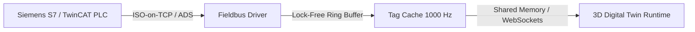

# industrial-fieldbus-opcua

High-performance OPC UA and Siemens S7 PLC communication bridge for hardware-in-the-loop (HIL) virtual commissioning and real-time digital twins.

## Features

- **Microsecond Timestamping**: Lock-free concurrent tag cache delivering updates at 1 kHz with minimal jitter.
- **Multi-Vendor PLC Support**: Native drivers for Siemens S7 (S7-300, S7-1200, S7-1500), Beckhoff TwinCAT ADS, and OPC Foundation client.
- **Fail-Safe Watchdog**: Automated heartbeat and reconnection logic for non-disruptive physical line commissioning.

## License

MIT License (c) 2018-2026 Gaurav Bhardwaj / OmegaGaze Lab.
